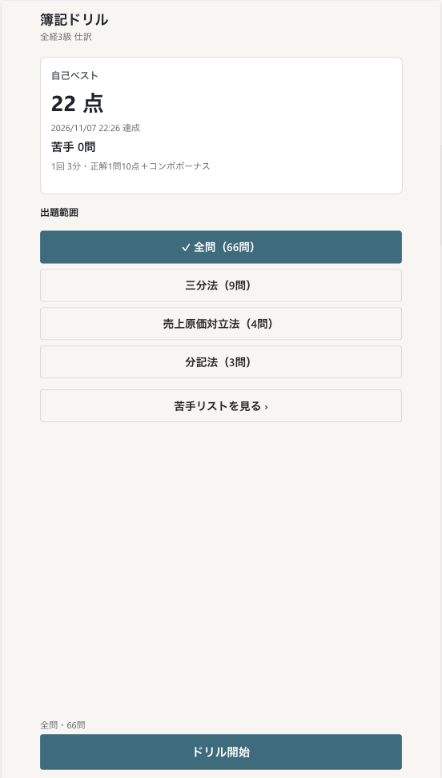
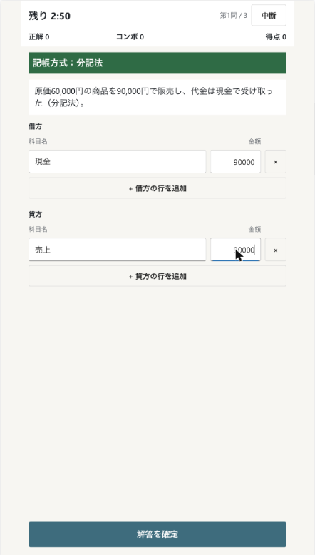
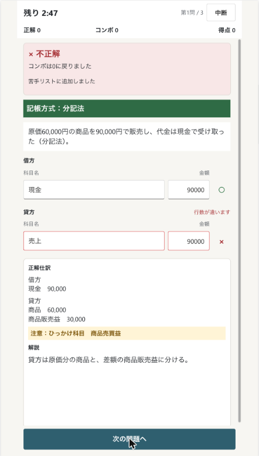
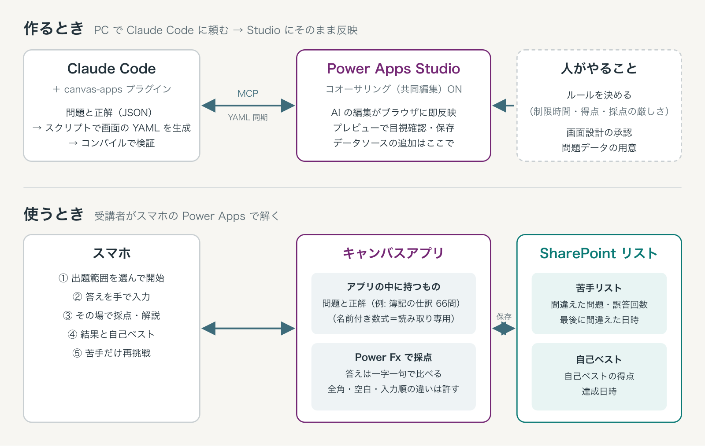

# 簿記ドリル（Power Apps キャンバスアプリ）

E-learning の習得度を「手で書かせて、その場で採点する」形で確かめる Power Apps キャンバスアプリの作例です。題材は全経簿記能力検定3級の仕訳（66問）です。

  

## できること

- 1回3分のドリル。正解1問10点、2問以上の連続正解でコンボボーナス
- 答えは選択式にせず手入力。科目名は一字一句で採点（全角数字・前後の空白・行の順番の違いは許す）
- 間違えた問題は SharePoint の苦手リストに入り、苦手問題だけで再挑戦できる。再挑戦で正解すると外れる
- 自己ベストを SharePoint に保存

## 構成



| パス | 中身 |
|---|---|
| `app/*.pa.yaml` | キャンバスアプリのソース（4画面: Screen1 / scrDrill / scrResult / scrWeak） |
| `data/questions.json` | 問題66問と正解仕訳（`tools/build_questions.py` から生成） |
| `data/accounts.json` | 勘定科目の一覧と別表記 |
| `tools/build_questions.py` | 問題データの原本。実行すると `data/questions.json` を作る |
| `tools/canvas/gen_app.py` | 問題データを `App.pa.yaml` の名前付き数式に変換する |
| `tools/canvas/gen_screens.py` | 4画面の `.pa.yaml` を生成する |
| `tests/test_questions.py` | 問題データの検査（借方と貸方の合計一致、科目が一覧にあるか など） |

問題と正解はアプリの中に名前付き数式（読み取り専用）として持ち、採点は Power Fx で完結しています。SharePoint に保存するのは苦手リストと自己ベストだけです。

## 動かすには

1. SharePoint サイトに次の2つのリストを作ります（列は英数字の内部名で作成）

   | リスト | 列 | 型 |
   |---|---|---|
   | BokiWeakList | Title（問題ID、一意の値） / MissCount / LastMissedAt | 1行テキスト / 数値 / 日付と時刻 |
   | BokiBestScore | Title（固定キー `best`、一意の値） / Score / AchievedAt | 1行テキスト / 数値 / 日付と時刻 |

2. Power Apps Studio で空のキャンバスアプリを作り、「モダン コントロールとモダン テーマ」を ON にして、SharePoint の2つのリストをデータソースに追加します
3. `app/` の `.pa.yaml` をアプリに反映します。作者は Claude Code の canvas-apps プラグイン（コオーサリング接続）で反映しました

## 題材を替えるには

`tools/build_questions.py` の問題を書き換えて、次を実行します。

```sh
python3 tools/build_questions.py          # data/questions.json を生成
python3 -m pytest tests                   # 問題データの検査
python3 tools/canvas/gen_app.py . app/App.pa.yaml
python3 tools/canvas/gen_screens.py app
```

検査と画面の表示（記帳方式の帯など）は簿記に合わせてあるので、題材に合わせて直してください。

## 未確認のこと

- 3分の時間切れでの画面の切り替えと、SharePoint への保存に失敗したときの表示
- スマホ実機での表示
- 利用者ごとの記録・管理者向けの集計（未実装）

## 解説記事

- note: E-learning の習得度を確かめるアプリを Power Apps で作ってみた（公開後にリンクを追加）

## ライセンス

MIT。問題文と解説は作者が独自に作成したもので、全経の過去問題は含みません。
